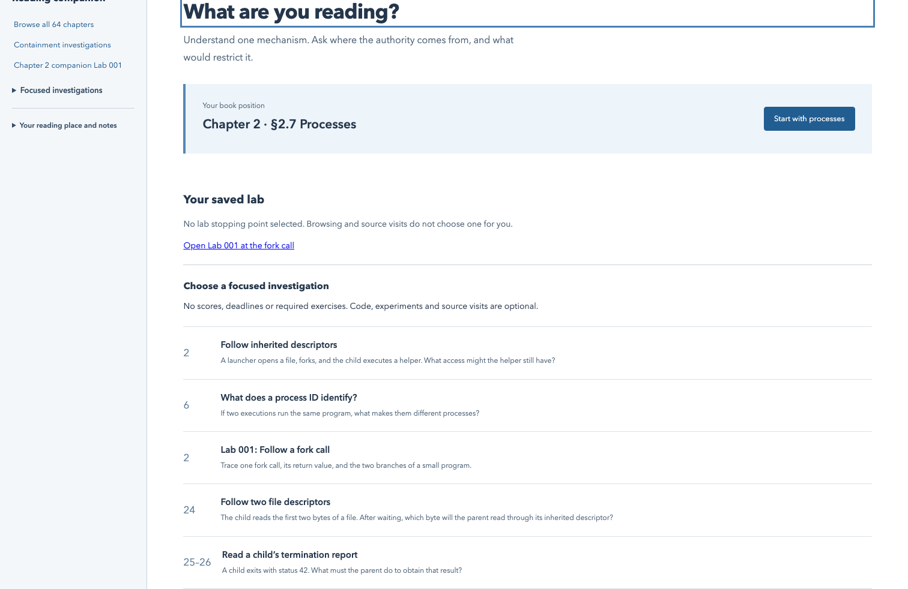
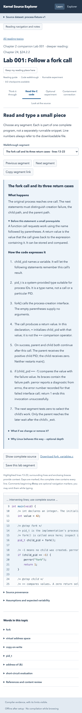
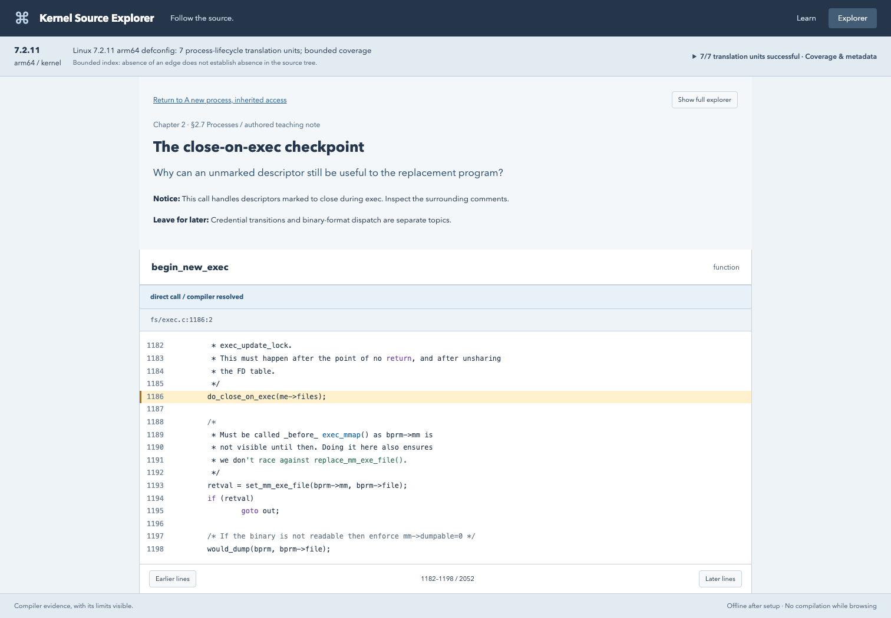

# Kernel Source Explorer

A local reading companion and source explorer for learning how Linux works. Bring a question from your reading, reason about it, and follow a few compiler-backed source checkpoints. Open the full symbol graph whenever you want to investigate further.



## Start with a question

The **Learn** home accompanies all **64 chapters** of Michael Kerrisk's *The Linux Programming Interface*, with a recurring question: **What authority does this process have, where did it come from, and what would actually restrict it?**

Every reading guide starts with a concrete situation, explains the central idea in small steps, then offers a reflection with an optional answer. Definitions appear where needed; diagrams, exact interfaces, assumptions, counterexamples and references supply optional depth. The separate developed investigations retain prediction-first reveals. Search by chapter, interface or concept. Start with [Chapter 2](http://127.0.0.1:8000/#learn/chapter-02); see the [64-chapter editorial record](docs/CURRICULUM_READING_REVIEW.md) for scope, examples and validation.

**Nine focused investigations** offer complete commented C files, numbered source, selectable walkthrough segments, optional experiments and variations. Each segment connects what happens, how C expresses it, and optional Linux depth, with just-in-time prerequisites. Previous/next controls and copied activity links preserve navigation independently of saved stops. Three additional examples cover launch preparation, child supervision and one actual seccomp boundary. The six mapped investigations retain **14 reviewed source checkpoints**. The additional examples have no authored kernel mapping.

Book position, saved lab segment and recent exploration are independent. Notes are optional and local, with schema migration, validated import/export, recovery previews and retained raw backups. There are no scores, deadlines, chapter gates or mandatory labs.

Open **[Chapter 2 companion Lab 001 at the fork segment](http://127.0.0.1:8000/#learn/fork-memory?view=code&segment=fork)**. Choose **Save this lab segment** to make Home → **Resume saved lab segment** return to `pid_t child_pid = fork();`. This does not advance the book or mark the experiment run.



The **Explorer** offers five familiar C questions alongside free symbol search and trails. **[Start with process creation](http://127.0.0.1:8000/#explore?guide=fork-memory)**: follow memory setup → the sharing choice → a stopping point connected to the C private-variable experiment. Essential statement explanations open beside source; full definitions are optional detours with a guided return. Selection orientation explains definitions versus call sites, reviewed responsibilities and structural facts. Nodes preview navigation; arrows select compiler evidence; the selected source token is marked. Guided/free links survive refresh with the originating question and source position. Source paging remains contiguous and graph groups expose individual evidence. See [the memory-journey handoff](docs/MEMORY_JOURNEY_PASS.md) for the recommended path and checks, and [the Explorer handoff](docs/EXPLORER_PASS.md) for broader annotation scope.



The optional **Containment investigations** track distinguishes private state, descriptor access, launch inputs, lifecycle supervision, credentials, resource control and syscall mediation. Namespaces, cgroups and Landlock are explicitly reading-only in this pass. The seccomp example denies one syscall and leaves almost everything else allowed; it is not a composed sandbox.

This is an independent companion, unaffiliated with the book's author or publisher. The PDF and book examples are not distributed. Explanations and experiments are original. You can use the reading topics without an index or without owning the book; reading pointers refer you to your own copy when available.

## Quick start

Prerequisites for the reading companion: Python 3.11+ and Node 22.12+ (Node 22 LTS tested).

```sh
git clone https://github.com/north-echo/kernel-source-explorer.git
cd kernel-source-explorer
make setup
make web
make serve
```

Open **http://127.0.0.1:8000** and choose a reading topic. Explanations begin hidden. To inspect real kernel checkpoints, prepare a dataset using [the Linux workflow](docs/KERNEL.md). Browsing needs no external network after dependencies, UI assets and any desired source/index are available. The browser never compiles or executes experiments.

On the development machine, the seven-unit validated kernel dataset is already available in `data/learning/`, so `make serve` selects it automatically. The server prefers `data/learning/index.sqlite`, then `data/kernel/index.sqlite`, then `data/fixture.sqlite`. Set `KSE_INDEX` to explicitly select another index; one dataset is open per server instance.

## Your personal reading layer

Everyone gets generic defaults. To supply a private starting point:

```sh
mkdir -p data
cp examples/reader.json data/reader-profile.json
```

The local profile can set your reading position, interests, Linux environment and an optional discussion reminder. It seeds a new browser; existing browser choices take precedence. Reading notes, self-reported experiment status and visited locations stay in browser storage. The profile, book PDFs, continuity documents, generated indexes and kernel source snapshots are excluded from Git.

See [personal setup and curriculum authoring](docs/LEARNING.md). The shared application and curriculum do not depend on a particular learner's history.

## Try source exploration with a small fixture

Additional prerequisites: CMake 3.20+, a C++17 compiler and matching LLVM/Clang **22 or 23** development libraries. Apple Clang alone does not supply LibTooling headers.

macOS:

```sh
brew install llvm cmake
make indexer
```

Ubuntu 26.04:

```sh
sudo apt-get install build-essential cmake clang-22 llvm-22-dev libclang-22-dev libclang-cpp22-dev
make indexer LLVM_PREFIX=/usr/lib/llvm-22
```

Then:

```sh
make fixture
KSE_INDEX="$PWD/data/fixture.sqlite" make serve
```

Choose **Explorer**, search `allocate_pid`, select outgoing direct calls, and click its edge to `helper`. The source opens at `process.c:5:37`. Search `spawn_task` for macro calls and unresolved callbacks. The fixture intentionally reports two successful, one partial and one skipped translation unit; these are not kernel results. If necessary, select a compiler explicitly with `.venv/bin/kse fixture --compiler /path/to/clang-22` before indexing.

## Actual kernel validation

Linux **7.2.11**, commit `a2de78ee6ed8bf8cd99d177c74865a6e8c3cb6ea`, was signature-verified and built with arm64 `defconfig`. The learning index covers seven translation units: `kernel/fork.c`, `kernel/pid.c`, `kernel/cred.c`, `kernel/exit.c`, `kernel/sys.c`, `fs/exec.c` and `fs/file.c`.

All seven succeeded with zero diagnostics. The run produced **91,590 symbols**, **413,584 relationship evidence records** and **14 available learning checkpoints** in **55.02 seconds**. This remains a bounded partial kernel index. It does not infer indirect-call targets or provide automatic security analysis.

An optional `--profile isolation` (or `all`) preparation adds the open path, LSM framework, Landlock, SELinux and seccomp translation units with the security options they need; see [the Linux workflow](docs/KERNEL.md#optional-isolation-translation-units). Its configuration, object builds and compilation-database selection were checked on x86_64 with Clang 18 against the same pinned 7.2.11 commit (18 of 18 units). It has not yet been indexed with the LLVM 22 indexer or run on arm64, and no learning checkpoints use it.

Nine original experiment programs passed 23 unprivileged validation cases (11 canonical runs, eight variations, two deliberately broken launchers detected, and two explicitly simulated zero-baseline checks) on an Ubuntu 26.04 aarch64 VM running Linux 7.0.0-28-generic, UID 501, with Clang 22.1.2. Seccomp was installed successfully with CONFIG_SECCOMP and CONFIG_SECCOMP_FILTER enabled; an actual getppid syscall was rejected with EPERM while getpid remained allowed. That running system is separate from the indexed 7.2.11 source. Fedora and x86-64 execution were not validated. The VM refused the optional actual PID-namespace creation probe; zero-baseline branch checks do not claim namespace execution. No privileged host-policy changes were needed.

See [validation and limitations](docs/VALIDATION.md), [learning-index measurements](docs/learning-validation.json) and [current experiment results](docs/followup-experiment-validation.json).

## Checks and development

```sh
.venv/bin/pytest -q
npm run build --prefix web
cd web
npx playwright install chromium --only-shell
npm run test:e2e
npm run test:kernel                 # optional: requires data/learning and its matching demo trail
```

Fixture and learning browser checks use port 8765; real-kernel checks use 8766. The normal service on port 8000 can remain running. This improvement pass is local and has not been pushed or run in remote CI. The existing CI workflow builds the native fixture, runs the Python tests and exercises the reading/explorer UI; it does not download or claim a real kernel index.

- `indexer/`: standalone single-TU C++ Clang LibTooling analysis.
- `explorer/cli.py`: explicit sequential indexing, SQLite ingestion and atomic publication.
- `explorer/schema.sql`: schema v1; schema changes require a version bump and rebuild.
- `explorer/api.py`: read-only local service; source is limited to registered, hash-verified roots.
- `explorer/chapters.json`, `explorer/lessons.json`, `explorer/learning.py`, `explorer/experiments/`: original shared reading collection and evidence resolution.
- `web/`: React/TypeScript, Cytoscape.js and locally bundled highlighting.

For the review findings, acceptance evidence and remaining limits, see [the improvement report](docs/IMPROVEMENT_PASS.md).

For UI development, run the API on port 8000 and `npm run dev --prefix web`; Vite serves port 5173 and proxies `/api`. Production serves the built UI from FastAPI.

The service uses loopback hosts/origins, parameterized SQL, bounded responses, component-wise symlink rejection and source hashes. Indexing accepts trusted compilation databases only through the explicit CLI. This is a single-user local application.

The project was implemented fresh, with Sourcetrail's coordinated views as a design reference. No Sourcetrail code, artwork or branding was copied. See [the original implementation specification](IMPLEMENTATION_SPEC.md). The original application and companion material are [MIT licensed](LICENSE); dependencies and displayed kernel/book material retain their own rights. See [third-party notices](THIRD_PARTY_NOTICES.md).
