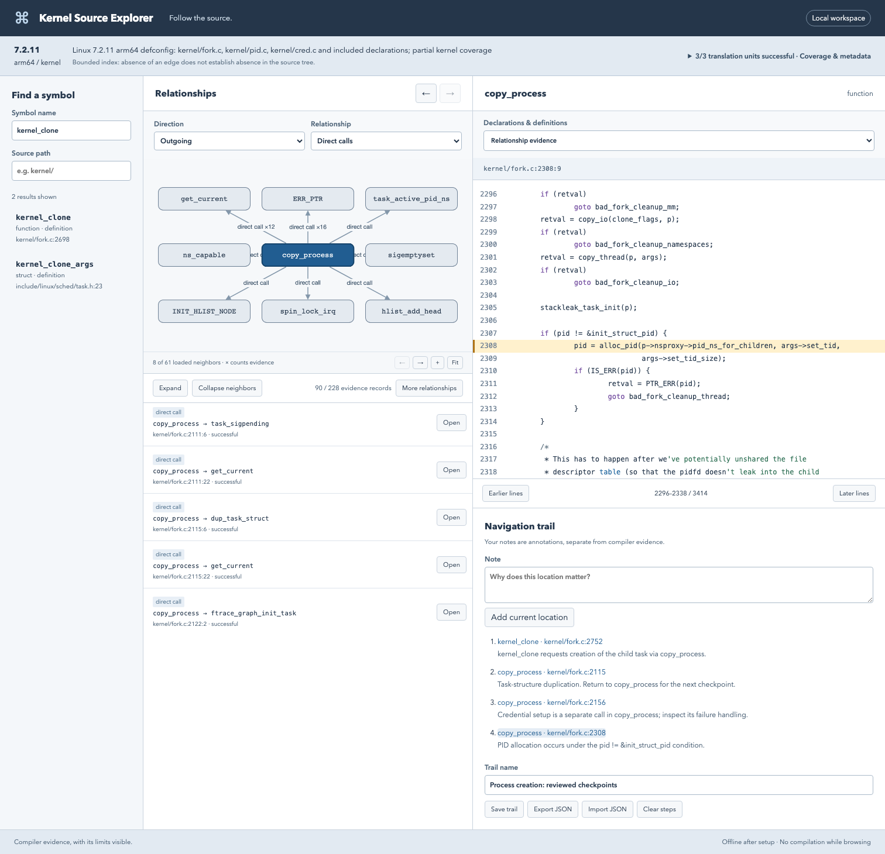

# Linux Kernel Source Explorer

A local source explorer for Linux kernel learning and investigation. Search symbols, follow compiler-resolved relationships, and open their supporting source locations in coordinated graph and source views. Fresh implementation inspired by Sourcetrail; no Sourcetrail code or branding is included.

## Current status

The vertical slice, bounded kernel integration, exploration controls, and focused hardening are implemented. Linux **7.2.11**, commit `a2de78ee6ed8bf8cd99d177c74865a6e8c3cb6ea`, was signature-verified, built with arm64 `defconfig`, and indexed for `kernel/fork.c`, `kernel/pid.c`, and `kernel/cred.c`. All three translation units succeeded with no diagnostics. This is a **partial kernel index**.

The run produced 59,899 symbols and 180,708 relationship evidence records in 26.38 seconds. See [validation and limitations](docs/VALIDATION.md), [measured kernel results](docs/kernel-validation.json), and the [implementation specification](IMPLEMENTATION_SPEC.md).



## Quick start with the fixture

Prerequisites: Python 3.11+, Node 22.12+ (Node 22 LTS tested), CMake 3.20+, a C++17 compiler, and matching LLVM/Clang **22 or 23** development libraries. The tested versions are LLVM 23.1.3 on macOS and LLVM 22.1.2 on Ubuntu 26.04 arm64. Apple Clang alone does not supply LibTooling development libraries.

macOS build prerequisites:

```sh
brew install llvm cmake
```

Ubuntu 26.04 build prerequisites:

```sh
sudo apt-get install build-essential cmake clang-22 llvm-22-dev libclang-22-dev libclang-cpp22-dev
```

From the repository root:

```sh
make setup
make indexer                         # macOS default LLVM prefix
# Linux: make indexer LLVM_PREFIX=/usr/lib/llvm-22
make fixture
make web
make serve
```

Open **http://127.0.0.1:8000**. Search `allocate_pid`, select its outgoing direct call to `helper`, and inspect `process.c:5:37`. Search `spawn_task` for the macro call and unresolved callbacks. Coverage intentionally includes one partial and one skipped translation unit. These are fixture results, not kernel results.

`make setup` installs the exact Python dependency versions in `requirements.lock` and uses the npm lockfile. If `clang` is not on PATH, generate the fixture commands with `.venv/bin/kse fixture --compiler /path/to/clang-22` before indexing.

## Browse the prepared kernel dataset

The validated dataset and source snapshot are present locally under `data/kernel/` and excluded from Git. After building the web interface:

```sh
KSE_INDEX="$PWD/data/kernel/index.sqlite" make serve
```

Search `kernel_clone`. Choose outgoing direct calls and select `kernel_clone → copy_process` to open `kernel/fork.c:2752`. Import [the reviewed process-creation trail](docs/process-creation-trail.json) with the trail panel. Notes are user annotations, separate from compiler evidence.

Only one dataset is open per service instance; select it with `KSE_INDEX` before starting the service. Dataset IDs guard against stale navigation if an index is replaced. Trails are tied to the exact dataset, saved in this browser's local storage, and exported/imported as JSON. Rebuilt datasets need a freshly generated demonstration trail.

To reproduce the kernel preparation and index, see [the Linux workflow](docs/KERNEL.md). No installation or boot of the indexed kernel is required. Once source, dependencies, the built UI, and the index are available, browsing requires no external network access.

## Validation

```sh
.venv/bin/pytest -q
npm run build --prefix web
cd web
npx playwright install chromium --only-shell
npm run test:e2e
npm run test:kernel                  # requires data/kernel/index.sqlite and matching demo trail
```

Use Node 22 LTS if your Node version has trouble installing Playwright browsers. Browser tests bind port 8000 themselves; stop a manually running service first. See [validation details](docs/VALIDATION.md) for actual results and limits.

## Development

- `indexer/`: single-TU C++ Clang LibTooling executable; emits compiler facts and diagnostics as JSON.
- `explorer/cli.py`: explicit sequential index driver; stores facts in SQLite and atomically publishes replacements.
- `explorer/schema.sql`: schema v1. Schema changes require a version bump and a dataset rebuild; no migrations are supported yet.
- `explorer/api.py`: read-only FastAPI service. The index itself is selected by the server, never by an HTTP file path.
- `web/`: React/TypeScript, Cytoscape.js, locally bundled C syntax highlighting.
- `fixtures/`, `tests/`, `web/e2e/`, `web/kernel-e2e/`: focused compiler, service, and browser checks.

For UI development, start the API on 127.0.0.1:8000 and `npm run dev --prefix web`; Vite proxies `/api` locally on port 5173. Production serves the built interface from FastAPI.

The service binds loopback by default in the documented commands. It permits only explicit loopback hosts/origins, uses parameterized SQL, bounds responses, rejects symlink source paths, and refuses changed source contents. Browsing never executes compilation commands. Indexing accepts trusted compilation databases through an explicit local CLI operation.

A project license has not been selected. Kernel sources, indexes, generated source snapshots, and build products are excluded from Git.
